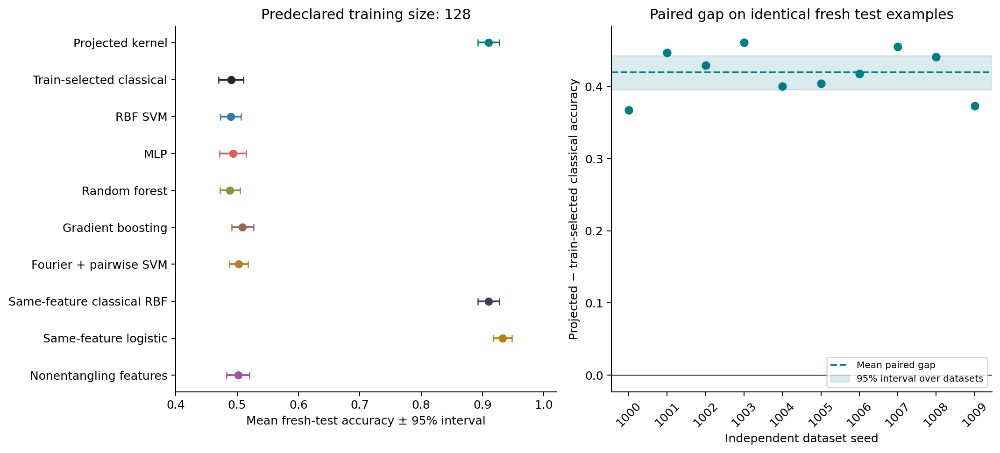
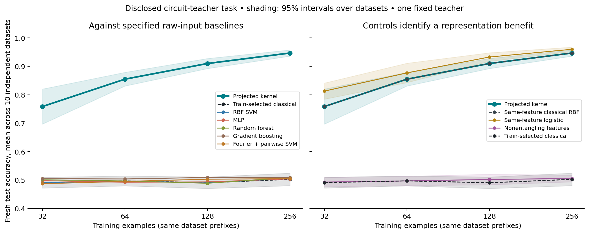

# Engineered task: a reproducible representation win

This is a disclosed synthetic task engineered to favor a fixed quantum-circuit
representation. It establishes no computational quantum advantage. All circuit
features are obtained by exact **classical** statevector simulation.

## Predeclared primary result

At **128 training examples**, the projected kernel reaches
**0.910** mean accuracy on fresh test data. The classical
baseline selected exclusively by training CV reaches **0.490**.
The paired gap is **+0.420**, with a 95% interval
**[+0.396, +0.443]** across ten independently
generated datasets (10 wins, 0 ties, 0 losses).
The largest mean among the five individual raw-input baselines is 0.509;
that maximum is descriptive and was not used for the primary comparator selection.

| Model | Mean accuracy, n=128 | 95% interval over datasets |
|---|---:|---:|
| Projected quantum kernel | 0.910 | [0.892, 0.928] |
| Classical raw-input selection | 0.490 | [0.470, 0.510] |
| RBF SVM | 0.490 | [0.473, 0.507] |
| MLP | 0.493 | [0.472, 0.515] |
| Random forest | 0.488 | [0.472, 0.505] |
| Gradient boosting | 0.509 | [0.491, 0.527] |
| Fourier+pairwise SVM | 0.503 | [0.487, 0.518] |
| Classical same-feature RBF | 0.910 | [0.892, 0.928] |
| Classical same-feature logistic | 0.933 | [0.918, 0.948] |
| Nonentangling projection RBF | 0.502 | [0.483, 0.520] |



The **classical same-feature RBF model makes identical predictions** to the
projected quantum kernel in every evaluated case. The classical same-feature
logistic model sees the exact observables used by the linear teacher and is an
informed control, not an independent raw-input competitor. These controls show
that the win is due to a favorable representation; the learning algorithm after
feature extraction is classical.

## Frozen task and evaluation

- Six input coordinates are drawn iid uniformly from [-π, π]. The fixed circuit
  has six qubits and two encoding/entangling layers. Each layer applies
  Ry(2x_q + fixed offset), Rz(x_neighbor + fixed offset), a CNOT chain and its
  closing CNOT. Offset seed is 271828; teacher-weight seed is 271829.
- The feature vector consists of local X, Y and Z expectation values: 18 real
  numbers. Labels threshold a fixed weighted sum of those features. There is
  no label noise or post-hoc rejection of difficult examples. A separate
  1024-point calibration draw fixes the median threshold before evaluation.
- The projected kernel is exp(-γ||F(x)-F(x')||²). Local Pauli features encode the
  single-qubit reduced density matrices; the squared feature distance equals
  twice the summed squared Frobenius distance between those matrices, with that
  factor absorbed by γ. The implementation is inspired by projected kernels in
  [Huang et al. (2021)](https://www.nature.com/articles/s41467-021-22539-9),
  **not a replication of their engineered dataset or quantum-hardness result**.
- Ten fresh dataset seeds (1000–1009), each with training prefixes of
  32/64/128/256 and a separate fixed test set of 512. Every baseline shares
  these samples. Training and test use distinct deterministic RNG streams.
- Hyperparameters are selected by identical shuffled stratified 3-fold inner
  CV. Standardization for raw-input baselines is fit inside each training fold.
  Deterministic circuit and Fourier features fit no parameters on any data.
- Raw-input competitors: RBF SVM; a small MLP with Adam/L-BFGS and two architectures;
  random forest; histogram gradient boosting; and an SVM over coordinate
  Fourier frequencies 1–4 plus all pairwise products (1224 features).
- The nonentangling ablation retains encoding/offsets but removes CNOT gates.
  Same-feature RBF and logistic controls use the 18 exact entangling features.
- The **primary comparison was frozen at n=128** against a classical baseline
  chosen using inner CV, not test accuracy. Other training sizes and individual
  comparator intervals are secondary, unadjusted exploratory results.
- 95% intervals use Student-t uncertainty over the ten independent datasets,
  conditional on this one teacher. Sizes share training prefixes and test sets
  within a seed and must not be treated as independent additional runs.



## Provenance and limits

`experiments/engineered_protocol.json` was frozen at
`2026-10-24T06:44:24.053907+00:00`. Evaluation started at
`2026-10-24T06:44:25.549668+00:00`. Source and protocol hashes are checked before
running and independently checked by the reporting script. The execution record
contains the final completion time; the run took 349.1s.

The separate pilot uses seed 101 with 128/256 train/test examples. An initial
pilot exposed MLP convergence warnings; before freezing, its grid was expanded
to Adam plus L-BFGS and a larger iteration budget. Teacher, input distribution,
feature map and labels did not change. Initial and final pilot outputs are
preserved in `results/engineered/pilot_initial/` and `pilot/`. No evaluation
seed was used for those decisions. This is a local protocol freeze with saved
hashes, not a third-party timestamped preregistration.

All tuning warnings are saved by dataset. Across evaluation fits the recorded
counts are: Classical raw-input selection: 6, Gradient boosting: 1, MLP: 62. Counts include warnings from inner tuning fits;
they are not necessarily failures of the final selected estimator. Counts for
the classical-selection row reuse its chosen fit, rather than additional fits.
Finite grids
and optimizer budgets cannot establish superiority over all classical learners.

The task is intentionally favorable to its teacher representation. A classical
method that computes the same features can match it, and this repo does exactly
that. The disclosed teacher itself is also an exact classical labeling oracle at
this scale; the benchmark restricts learners to their specified inputs and training
examples. Only one teacher, six qubits, exact simulation and one input distribution
were studied. We measure no hardware/runtime advantage and make no claim about
ordinary real-world data. The earlier breast-cancer benchmark remains a useful
counterexample to assuming the representation will help everywhere.

## Reproduce and inspect

From the repo root in the environment from `requirements.txt`:

```bash
# The supplied protocol is already frozen. Do not refreeze after seeing results.
python scripts/run_engineered.py --stage evaluate --overwrite
python scripts/report_engineered.py
python scripts/build_notebooks.py --execute
PYTHONPATH=src python -m unittest discover -s tests -v
```

`--overwrite` reproduces the **unchanged** frozen protocol; scientific source
edits are rejected. To study another task, preserve this protocol/results and
create a separately versioned experiment rather than replacing the freeze.

- `scores.csv`: every model/dataset/training size and training-selected parameters.
- `summary.csv`: accuracy means and intervals; `paired_comparisons.csv`: paired gaps.
- `dataset_seed*.npz`: raw inputs, exact features, labels and ablation features.
- `predictions_seed*.npz`: predictions for independent score recomputation.
- `warnings_seed*.json`: recorded tuning warnings, without silently discarding runs.
- `execution.json` and `validation.json`: timing, hashes and integrity checks.
- `notebooks/04_engineered.ipynb`: executed report with paired plots and controls.

**Defensible claim:** On this disclosed circuit-teacher task, projected circuit
features improve prediction over the specified tuned raw-input baselines at
small training sizes. Classical learning with those same features matches or
exceeds the projected-kernel model. This is a representation result, not a
quantum computational speedup.
