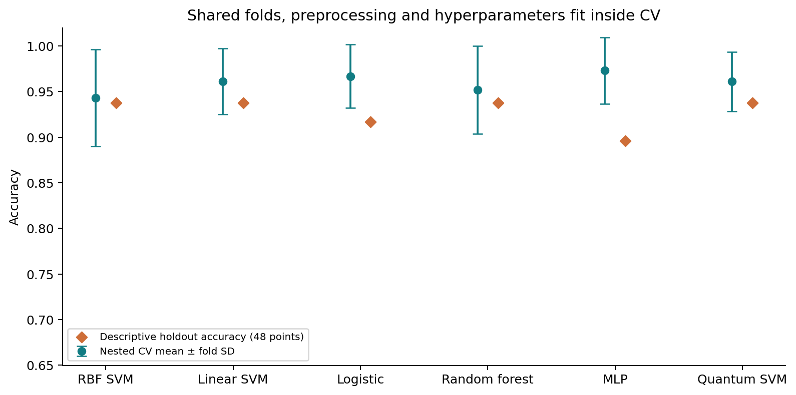
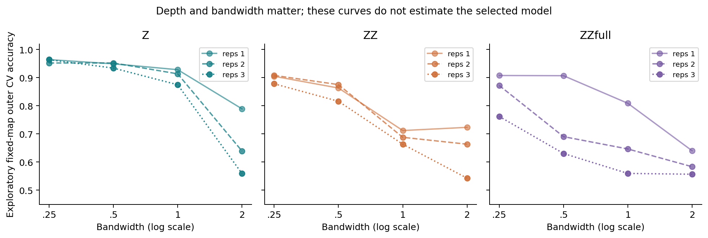
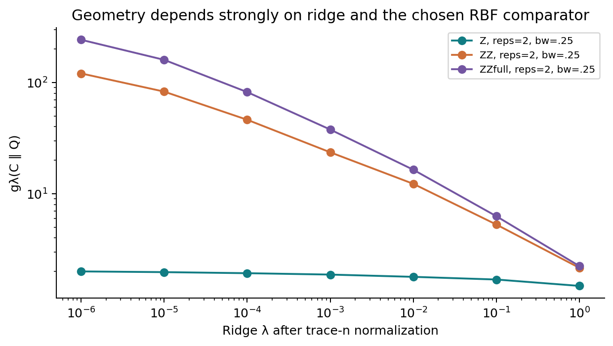
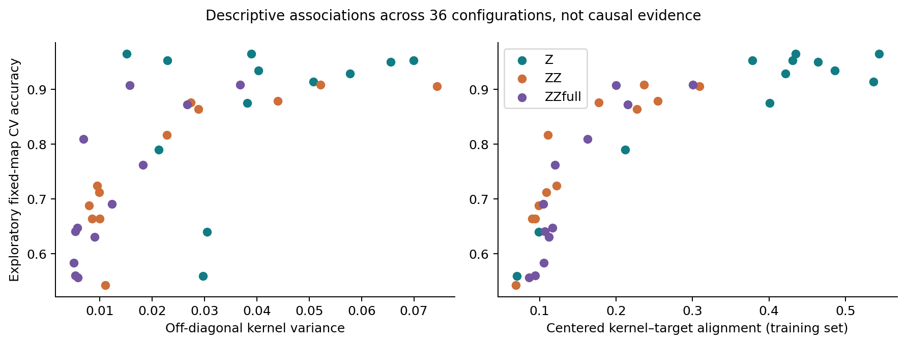
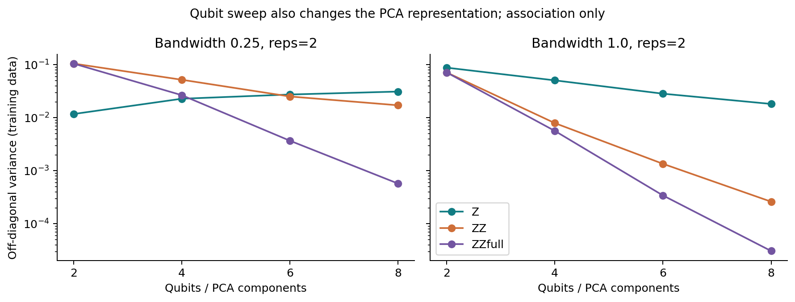
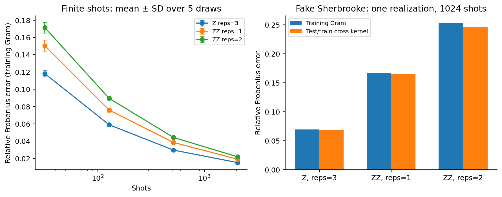

# When does a quantum kernel have a chance?

**A fair, reproducible quantum-kernel benchmark, plus cheap diagnostics that tell you
whether to bother.** Qiskit Fall Fest hackathon entry, **Track 2**.

| | |
|---|---|
| Team | **AadityaVichare** (solo) |
| Member | Aaditya Vichare |
| Track | 2 (quantum machine learning benchmark) |
| Licence | MIT |
| Hardware | Simulator only. Noise studied on a packaged `FakeSherbrooke` snapshot; no QPU run |

## In one minute

**Question.** Should you try a quantum kernel on your data?

**Answer from this repo.** On small real data, probably not. A quantum-kernel SVM ties
the classical models, the best quantum map is a non-entangling one that a laptop simulates
exactly, and we do not claim a quantum advantage. The contribution is the *method*:

1. **A fair protocol.** Same features, same outer folds, and every tuning choice (including the
   quantum feature map, depth and bandwidth) made inside training folds only. Nested CV
   scores the whole selection procedure, with paired fold comparisons.
2. **Three regimes, one verdict.** Real data (breast cancer) and a control (circles) both tie.
   A disclosed engineered task shows a large win, but a classical model fed the *same exact
   circuit features* matches it, so the gain lives in the representation, not the quantum learner.
3. **Diagnostics that help.** Centered kernel-target alignment, computed on training data
   without any CV, ranks quantum-kernel configurations well on breast cancer
   (Spearman +0.93 pooled, +0.85 within a fixed bandwidth) but not on circles (+0.33). Geometric
   difference from the RBF kernel goes the *wrong way* for predicting wins: larger values
   accompany lower accuracy in both datasets (-0.79, -0.94). "Different from RBF" is not "better than RBF".
   These are exploratory (correlated configs, one seed); see `results/diagnostic_validity.csv`.
4. **Reusable pieces.** A scikit-learn-compatible `QuantumKernelSVC` (`src/qkb/estimator.py`),
   exact/shot/noisy kernel routines, tested diagnostics, executed notebooks.



### Results at a glance

| Setting | Quantum kernel | Best-matched classical | Verdict |
|---|---|---|---|
| Breast cancer, 4 qubits, nested CV | 0.961 ± 0.033 | RBF SVM 0.943 ± 0.053; MLP 0.973 ± 0.036 | Tie |
| Circles control, 2 qubits, nested CV | about 0.997 | RBF SVM about 0.997 | Tie |
| Engineered task, n=128, 10 fresh datasets | 0.910 | Raw-input baselines 0.490; same-feature classical RBF **0.910** | Representation win, not a quantum win |
| Noise (relative kernel error, fake backend) | Z 0.07, ZZ-1 0.17, ZZ-2 0.25 | n/a | Entangling maps are more fragile |

### Where to look
- Fast read: this page, then [`ENGINEERED_RESULTS.md`](ENGINEERED_RESULTS.md).
- Notebooks (executed): `notebooks/01_benchmark`, `02_diagnostics`, `03_noise`, `04_engineered`.
- Run it yourself: see [Reproduce](#reproduce). Unit tests: `PYTHONPATH=src python -m unittest discover -s tests -v`.
- Use the estimator:

```python
from qkb.estimator import QuantumKernelSVC          # inputs are angles, e.g. scaled to [0, pi]
clf = QuantumKernelSVC(fmap="Z", reps=1, bandwidth=0.25, C=10).fit(X_train, y_train)
print(clf.predict(X_test))                           # works inside GridSearchCV / Pipeline
```

## Honest limits (read before the details)
- Single seed, small data (160 samples, 4 qubits). No claim of generality, clinical use, speedup,
  or hardware advantage.
- The holdout was viewed during development, so it is descriptive, not fresh confirmation.
- The engineered task is built to favour its own circuit. We disclose that and run the control that exposes it.
- The diagnostic-validity numbers are exploratory.
- Noise results use one fake-device snapshot, not a real QPU.

## Related work and how this differs
- Bowles, Ahmed and Schuld, *Better than classical? The subtle art of benchmarking quantum machine
  learning models* (2024), with code at [XanaduAI/qml-benchmarks](https://github.com/XanaduAI/qml-benchmarks)
  (Apache-2.0). We follow its scikit-learn estimator convention and its spirit of testing against
  well-tuned classical baselines and of ablating entanglement (our Z-versus-ZZ comparison). This repo is
  independent code: Qiskit rather than PennyLane/JAX, quantum *kernels* rather than variational models,
  and added emphasis on nested selection, kernel diagnostics and fake-backend noise.
- Huang et al., *Power of data in quantum machine learning*, Nat. Commun. 12, 2631 (2021): the source
  of the geometric-difference and projected-kernel ideas used here. We implement a ridge-stabilised
  variant and do not replicate their hardness results.

## Engineered task extension

> Read this section together with the same-feature control below: the large gain is a property of the circuit features, which a classical learner can use equally well.

The second experiment tests a task deliberately matched to a fixed entangling
circuit representation. It uses ten fresh datasets, a frozen primary comparison,
stronger raw-input baselines, and classical controls given the same exact circuit
features. See [engineered results and limits](ENGINEERED_RESULTS.md) and the
executed [fourth notebook](notebooks/04_engineered.ipynb). This is a representation
comparison under exact classical simulation, with no quantum speedup claim.

At the frozen primary training size of 128, accuracy is **0.910 vs 0.490** for
the train-selected raw-input baseline (ten fresh datasets; paired gap 95%
interval **[+0.396, +0.443]**). Same-feature classical RBF also scores 0.910,
and same-feature logistic regression scores 0.933. The result supports a
matched representation benefit.

## Measured results

Breast-cancer data: 160 balanced samples, 112 train / 48 test, 4 PCA features,
seed 0. CV values below evaluate the **whole selection procedure**, including
quantum feature-map/depth/bandwidth selection inside each outer training fold.

| Model | Nested CV accuracy, mean ± fold SD | Descriptive test accuracy |
|---|---:|---:|
| SVM-RBF | 0.943 ± 0.053 | 0.938 |
| SVM-linear | 0.961 ± 0.036 | 0.938 |
| LogReg | 0.967 ± 0.035 | 0.917 |
| RandomForest | 0.952 ± 0.048 | 0.938 |
| MLP | 0.973 ± 0.036 | 0.896 |
| QKernel-SVM (nested selection) | 0.961 ± 0.033 | 0.938 |

Final train-only selected quantum configuration: `{'fmap': 'Z', 'reps': 1, 'bandwidth': 0.25, 'C': 10}`.
The selected map can differ across outer folds; all selections are recorded.

Against RBF SVM, the paired quantum-minus-RBF fold accuracy difference is
+0.0178 ± 0.0317 (descriptive SD), with
4 quantum wins, 11 ties and 0 RBF wins.
Repeated folds share data, so this is not an independent-fold significance test.
One test sample changes accuracy by 1/48 ≈ 2.08 percentage points. The holdout
was already viewed during project development and is not fresh confirmation.


## Where classical wins

- The best fixed entangling-map CV means are below the strongest classical
  baselines on this dataset. Exploratory fixed-map maxima are: Z: 0.964, ZZ: 0.908, ZZfull: 0.908.
  These maxima are descriptive; choosing one using these same outer folds would
  introduce selection bias. The main benchmark uses nested selection instead.
- Z has no entangling gates and its fidelity kernel is efficiently classically
  simulable. It cannot support a computational quantum-advantage claim.
- Circles gives RBF and quantum selection approximately 0.997 nested CV accuracy;
  both score 1.000 on its holdout. Ordinary nonlinear structure does not require
  a quantum kernel. Linear baselines perform poorly on this control as expected.
- Small statevector kernels are cheap to simulate. This project measures no
  hardware speedup, asymptotic advantage, or end-to-end resource advantage.



## Protocol and fairness

1. Select 80 examples from each class using seed 0, then make one stratified
   70/30 train/test split. Every method shares the sample IDs and outer folds.
2. Use 5 outer stratified folds × 3 repeats. In each outer training partition,
   use the same shuffled 3-fold inner splits for every method.
3. Fit standardization → PCA → MinMax angle scaling **inside every inner training
   fold**, then refit on the outer training partition for its validation score.
   All methods receive the same angle features. Out-of-range validation/test
   angles are intentionally not clipped to the training interval [0, π].
4. Tune RBF/linear SVM and logistic C in [0.1, 1, 10, 100]; RBF gamma in
   [0.01, 0.1, 0.3, 1, 'scale']; forest depth in [3, None] with 100 trees;
   MLP sizes [(8,), (16, 8)] and alpha [0.0001, 0.01].
5. Tune quantum C over the same grid, map in [Z, ZZ, ZZfull], reps in [1,2,3],
   and bandwidth in [0.25,0.5,1,2] inside inner CV: 36 map configurations.
   Ties use declared configuration order then ascending C. Two-qubit circles
   omits ZZfull because it duplicates linear ZZ connectivity, leaving 24 configs.
6. For final holdout fits, repeat inner selection using only the full training
   split. Never select by test accuracy. Save outer-fold accuracy/F1, paired
   differences, IDs, selected configurations, and the actual RBF gamma.

The grids are small and unequal in size; the comparison is fair about data
access, not an exhaustive or compute-matched search. Data balancing changes
class prevalence from the original dataset. F1 treats class 1 as positive.
Fold SD uses ddof=0 and is not a confidence interval. This is a single seed and
a small dataset, with no claim of generality or clinical usefulness.

## Diagnostics and the geometric-difference correction

Exact fidelity kernels are computed from Qiskit statevectors and passed to
`SVC(kernel="precomputed")`. Maps are Z, nearest-neighbor ZZ, and all-to-all
ZZ (`ZZfull`); a separate IQP map is not implemented.

We save off-diagonal mean/variance, centered kernel–target alignment, and a
ridge inverse quadratic label-complexity surrogate. Low variance alone is not
proof that concentration caused a score change. Alignment and geometry use
training data only and are not CV performance estimates.

[Huang et al. (2021), Eq. 5](https://www.nature.com/articles/s41467-021-22539-9)
defines `g(C || Q) = sqrt(||sqrt(Q) inv(C) sqrt(Q)||₂)` for trace-n kernels.
The implementation uses a symmetric generalized eigenvalue problem and reports
an explicitly ridge-stabilized diagnostic with `C + λI`. This simple variant
is **not** the paper's complete regularized prediction-error bound.

There is no general √n ceiling for this kernel pair. For example, Q=I₂,
C=all-ones₂ and λ=0.001 give g=√1000≈31.62. With PSD trace-n kernels and positive
ridge, a general bound is √(n/λ). Thus the old large values were not, by themselves,
evidence of a normalization bug. Near-singular comparator directions can drive
them. The new solver avoids explicit inversion and matrix square roots, validates
PSD inputs, and sweeps λ from 10⁻⁶ to 1. A large g against this single tuned RBF
kernel does not establish advantage over optimized classical methods or predict
an SVM win.




The 2/4/6/8-qubit concentration sweep holds reps=2 and uses bandwidth 0.25 and 1.
PCA dimensionality changes with qubit count, so it does not isolate a qubit-only
causal effect.



## Do the diagnostics predict accuracy?

Spearman correlation between each training-only diagnostic and nested-CV accuracy across the
saved sweeps (`python scripts/run_diagnostic_validity.py`; no new quantum runs). Bandwidth drives both
quantities, so we also report the mean correlation within each fixed bandwidth.

| Diagnostic | Breast cancer pooled / within-bw (36 configs) | Circles pooled / within-bw (24 configs) |
|---|---:|---:|
| Centered alignment | +0.93 / +0.85 | +0.33 / +0.13 |
| Off-diagonal variance | +0.71 / +0.42 | +0.00 / -0.03 |
| Geometric difference vs RBF (ridge 1e-3) | -0.79 / -0.80 | -0.94 / -0.64 |
| Ridge label complexity | +0.72 / +0.65 | -0.85 / -0.54 |

Reading: alignment is a cheap screen on breast cancer but not a universal one. Geometric difference is
not a predictor of quantum wins here. Configs within a sweep are correlated, there is one seed, and
none of this is a significance test.

## Noise study

40 balanced training and 20 test samples, preprocessing refit on the 40 training
samples. C is selected with exact, fold-local inner CV for each prespecified
configuration, then frozen across noise levels. Five independent binomial draws
are used at each of 32, 128, 512, and 2048 shots. Fake Sherbrooke uses one
packaged calibration snapshot at 1024 shots. No account, credentials, or QPU job
is required.

| Configuration | Training relative error | Test/train relative error | Mean measured diagonal |
|---|---:|---:|---:|
| Z, reps=3 | 0.070 | 0.068 | 0.927 |
| ZZ, reps=1 | 0.167 | 0.165 | 0.829 |
| ZZ, reps=2 | 0.253 | 0.246 | 0.734 |

Errors are relative Frobenius errors versus the exact matrices. Training
unordered pairs are measured once and mirrored, including measured noisy
diagonals. A barrier separates the forward and inverse circuits during
transpilation. Rectangular cross kernels are never symmetrized based on shape.
Saved outputs include off-diagonal error, minimum eigenvalue and raw exact/noisy
matrices, plus fake-backend properties/configuration.

Raw shot/noisy Gram matrices can be indefinite. We record that and use them
without PSD projection or mitigation; SVC then lacks the usual PSD-kernel convex
optimization guarantee. Accuracy is descriptive: one sample changes it by five
percentage points. One fake-device snapshot and one noisy realization do not
characterize real hardware or calibration variation.



## Reproduce

Tested with Python 3.13.6 on macOS arm64. Top-level dependency versions are
pinned in `requirements.txt`; resolved versions and platform are also recorded
in `results/environment.json`. Transitive dependencies are not fully locked.

```bash
python3 -m venv .venv
source .venv/bin/activate
python -m pip install -r requirements.txt
PYTHONPATH=src python -m unittest discover -s tests -v
python scripts/run_all.py
```

Individual commands, run from the repository root:

```bash
python scripts/run_benchmark.py
python scripts/run_benchmark.py --dataset circles
python scripts/run_concentration.py
python scripts/run_noise.py --n-train 40 --n-test 20
python scripts/run_diagnostic_validity.py
python scripts/make_figures.py
python scripts/run_engineered.py --stage evaluate --overwrite
python scripts/report_engineered.py
python scripts/build_notebooks.py --execute
```

The corrected default breast-cancer benchmark took 232s
in this run; runtime varies by machine and concurrent load. The full noise study
took about a minute. CSVs and figure files are overwritten by reruns; copy any
results you wish to preserve first.

## Explore and review

- `notebooks/01_benchmark.ipynb`: executed results, paired comparison, circles.
- `notebooks/02_diagnostics.ipynb`: geometry checks, bandwidth/depth, qubits.
- `notebooks/03_noise.ipynb`: executed noise results and limitations.
- `notebooks/04_engineered.ipynb`: frozen teacher task, fresh-data learning curves and same-feature classical controls.
- Each notebook has a Jupytext percent-format `.py` companion. The benchmark
  and noise notebooks have opt-in `RERUN` cells; by default they inspect saved
  results. Use `jupytext --sync notebooks/01_benchmark.py` after editing a pair.
- `figures/`: PNG and SVG exports.
- `results/*/summary.json`: split IDs, selections and experiment settings.
- `results/legacy/`: clearly superseded original outputs, retained for provenance.

Nine analytical/pipeline tests cover generalized geometry, a counterexample to
the proposed ceiling, agreement with the direct formula, ridge sensitivity,
invalid/singular input handling, centered alignment, fidelity PSD/diagonals,
square cross-kernel handling, split/preprocessing isolation, and simulator
orientation. The original three notebooks and the engineered-task notebook are executed reports; model fitting is performed by the scripts.

Six further tests (15 in total, including the scikit-learn estimator) verify local-Pauli features against reduced density matrices,
projected-distance equivalence, direct/precomputed kernel equivalence, independent
RNG streams, and the fixed teacher/Fourier feature functions.

MIT licensed. Submission details (team AadityaVichare, Track 2) are in `SUBMISSION.md`.
